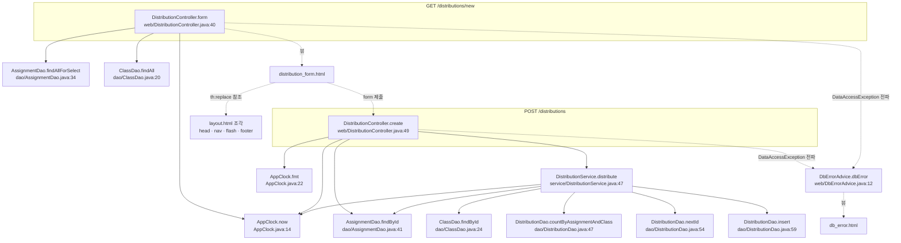

# legacy/assignment-thymeleaf 아키텍처 — "새 배포" 화면

> 범위: **"새 배포" 화면 하나**(`GET /distributions/new` 폼 → `POST /distributions` 등록)와 그 화면이 부르는 코드까지만 다룬다.
> 과제 목록(`/assignments`) · 배포 목록(`GET /distributions`) · 재배포(`POST /distributions/{id}/redistribute`, `DistributionService.java:70-701`)는 범위 밖이다.
>
> 근거 표기: 모듈 폴더(`legacy/assignment-thymeleaf/`) 기준 경로를 아래처럼 줄여 적는다.
> - Java: `src/main/java/com/example/assign/` 생략 → `web/DistributionController.java:60`
> - 템플릿: `src/main/resources/templates/` 생략 → `distribution_form.html:16`
> - 그 밖(`Dockerfile`, `src/main/resources/application.properties`)은 모듈 폴더 기준 그대로.

## 1. 모듈 개요

- Spring Boot + Thymeleaf 서버 렌더링 모듈이다. 진입 클래스는 `@SpringBootApplication` 인 `AssignApplication.java:6-11`.
- DB 는 `JdbcTemplate` 으로 MariaDB `itembank` 에 접속한다(`src/main/resources/application.properties:2-5`, `dao/AssignmentDao.java:15`). 문항 은행(item-bank)과 같은 DB 를 쓴다(`db/mariadb/init/01-schema.sql:73`).
- 계층: `web/*Controller` → `service/DistributionService` → `dao/*Dao`. 단, "새 배포" 화면에서는 컨트롤러가 DAO 를 직접 부르기도 한다(4절 호출 표 참고).
- 현재 시각은 `AppClock.now()` 가 준다. 시스템 속성 `app.clock=system` 이 없으면 **고정값 `2026-09-15 00:00:00`** 을 돌려준다(`AppClock.java:9`, `:14-19`). `Dockerfile:11` · `docker-compose.yml` 의 `assignment` 서비스 모두 `app.clock` 을 설정하지 않는다.

## 2. 폴더 구조

```
legacy/assignment-thymeleaf/
├── Dockerfile                                     11줄  gradle 8.10.2/JDK17 빌드 → temurin 17 JRE 실행
├── build.gradle · settings.gradle · gradlew*            (빌드 설정, 분석 대상 아님)
└── src/
    ├── main/java/com/example/assign/
    │   ├── AssignApplication.java                  12줄  부트 진입
    │   ├── AppClock.java                           28줄  now() · fmt()            ← 범위
    │   ├── web/
    │   │   ├── DistributionController.java        101줄  form() · create()       ← 범위 (list · redistribute 는 범위 밖)
    │   │   ├── DbErrorAdvice.java                  18줄  DataAccessException → db_error  ← 범위
    │   │   └── AssignmentController.java           35줄  과제 목록                 (범위 밖)
    │   ├── service/
    │   │   └── DistributionService.java           701줄  distribute() :46-68       ← 범위 (redistribute :70- 범위 밖)
    │   ├── dao/
    │   │   ├── AssignmentDao.java                  66줄  findAllForSelect · findById ← 범위
    │   │   ├── ClassDao.java                       42줄  findAll · findById         ← 범위
    │   │   └── DistributionDao.java               108줄  countByAssignmentAndClass · nextId · insert ← 범위
    │   └── model/
    │       ├── AssignmentRow.java                  79줄  ← 범위
    │       ├── ClassRow.java                       32줄  ← 범위
    │       ├── DistributionRow.java                97줄  (범위 밖)
    │       ├── RedistributeResult.java             89줄  (범위 밖)
    │       └── SubmissionRow.java                  53줄  (범위 밖)
    ├── main/resources/
    │   ├── application.properties                  14줄
    │   └── templates/
    │       ├── distribution_form.html              34줄  새 배포 폼              ← 범위
    │       ├── layout.html                         37줄  head · nav · flash · footer 조각 ← 범위(조각만)
    │       ├── db_error.html                       11줄  DB 오류 화면            ← 범위
    │       ├── assignments.html · distributions.html     (범위 밖)
    └── test/java/com/example/assign/
        └── AppClockTest.java                       20줄  고정 시각 · fmt 확인
```

## 3. 진입점

| URL · 화면 | 처음 실행되는 메서드 | 그 메서드가 부르는 것 | 결과 |
|---|---|---|---|
| `GET /distributions/new` (새 배포 폼) | `DistributionController.form(Model)` `web/DistributionController.java:40-47` | `assignmentDao.findAllForSelect()` `:42`, `classDao.findAll()` `:43`, `AppClock.now()` `:44` | 뷰 `distribution_form` `:46` |
| `POST /distributions` (배포 등록, 폼 제출) | `DistributionController.create(long assignmentId, long classId, RedirectAttributes)` `web/DistributionController.java:49-77` | `assignmentDao.findById(assignmentId)` `:53`, `AppClock.now()` `:58`, `AppClock.fmt(...)` `:62`, `distributionService.distribute(assignmentId, classId)` `:67` | 성공: `redirect:/distributions` `:76` / 실패: flash `error` + `redirect:/distributions/new` `:55-56`, `:62-63`, `:70-71`, `:73-74` |
| (예외) `DataAccessException` 이 컨트롤러 밖으로 나갈 때 | `DbErrorAdvice.dbError` `web/DbErrorAdvice.java:11-17` | `System.out.println` `:13` | 뷰 `db_error` `:16` |

- 폼은 `distribution_form.html:8` 의 `<form method="post" th:action="@{/distributions}">` 로 `POST /distributions` 에 제출한다. 파라미터 이름은 `assignmentId`(`:11`) · `classId`(`:23`).
- 상단 메뉴 "새 배포" 링크는 `layout.html:26` 이다.

## 4. 의존 관계

### 4.1 호출 그래프



- 실선은 본문에서 호출하는 줄을 인용할 수 있는 호출, 점선은 뷰 반환 · 템플릿 참조 · 폼 제출 · 예외 전파다.
- `AssignmentDao.findById` 는 **컨트롤러(`:53`)와 서비스(`:48`)에서 두 번** 불린다.

### 4.2 호출 표

| 호출하는 쪽 `파일:줄` | 호출 코드 | 호출되는 쪽 정의 `파일:줄` |
|---|---|---|
| `web/DistributionController.java:42` | `assignmentDao.findAllForSelect()` | `dao/AssignmentDao.java:34` |
| `web/DistributionController.java:43` | `classDao.findAll()` | `dao/ClassDao.java:20` |
| `web/DistributionController.java:44` | `AppClock.now()` | `AppClock.java:14` |
| `web/DistributionController.java:53` | `assignmentDao.findById(assignmentId)` | `dao/AssignmentDao.java:41` |
| `web/DistributionController.java:58` | `AppClock.now()` | `AppClock.java:14` |
| `web/DistributionController.java:62` | `AppClock.fmt(a.getDueAt())` | `AppClock.java:22` |
| `web/DistributionController.java:67` | `distributionService.distribute(assignmentId, classId)` | `service/DistributionService.java:47` |
| `service/DistributionService.java:48` | `assignmentDao.findById(assignmentId)` | `dao/AssignmentDao.java:41` |
| `service/DistributionService.java:52` | `classDao.findById(classId)` | `dao/ClassDao.java:24` |
| `service/DistributionService.java:59` | `distributionDao.countByAssignmentAndClass(assignmentId, classId)` | `dao/DistributionDao.java:47` |
| `service/DistributionService.java:62` | `distributionDao.nextId()` | `dao/DistributionDao.java:54` |
| `service/DistributionService.java:63` | `distributionDao.insert(id, assignmentId, classId, AppClock.now())` | `dao/DistributionDao.java:59`, `AppClock.java:14` |
| `dao/AssignmentDao.java:31`, `:38`, `:43` | `jdbc.query(sql, MAPPER, ...)` | `dao/AssignmentDao.java:50` (`MAPPER`) |
| `dao/ClassDao.java:21`, `:25` | `jdbc.query(..., MAPPER, ...)` | `dao/ClassDao.java:32` (`MAPPER`) |

참조(호출 아님):

| 참조하는 쪽 | 대상 |
|---|---|
| `distribution_form.html:3`, `:5`, `:7`, `:32` (`th:replace`) | `layout.html:3` `head`, `:23` `nav`, `:28` `flash`, `:35` `footer` 조각 |
| `distribution_form.html:8` (`th:action="@{/distributions}"`) | `web/DistributionController.java:49` `@PostMapping("/distributions")` |
| `web/DbErrorAdvice.java:11` (`@ExceptionHandler(DataAccessException.class)`) | 컨트롤러 밖으로 나가는 `DataAccessException` 전부 |
| `web/DistributionController.java:23-24`, `:28-29` | `AssignmentDao` · `ClassDao` 를 컨트롤러가 직접 주입받는다 |

### 4.3 예외 경로

| 발생 위치 | 예외 | 처리 위치 | 사용자에게 보이는 것 |
|---|---|---|---|
| `form()` 안 DAO 호출 `:42-43` | `DataAccessException` | `web/DbErrorAdvice.java:11-17` | `db_error.html` + 원인 메시지(`:15`, `db_error.html:8`) |
| `create()` 의 `assignmentDao.findById` `:53` — `try` 밖 | `DataAccessException` | `web/DbErrorAdvice.java:11-17` | `db_error.html` |
| `distribute()` 안 `:50`, `:54` | `IllegalArgumentException` | `web/DistributionController.java:69-71` | flash `error` = 예외 메시지, 폼으로 되돌아감 |
| `distribute()` 안 `:57`, `:60`, `:65` | `IllegalStateException` | `web/DistributionController.java:69-71` | flash `error` = 예외 메시지 |
| `distribute()` 안 DAO 호출 | `DataAccessException` | `web/DistributionController.java:72-74` | flash `error` = `"DB 오류로 배포에 실패했습니다."` |

## 5. 미확인 목록

- `assignmentId` · `classId` 가 비었거나 숫자가 아닐 때(폼 기본 옵션 `value=""` `distribution_form.html:12`, `:24`)의 서버 동작. `@RequestParam("assignmentId") long` (`web/DistributionController.java:50-51`) 이라 Spring 기본 400 응답일 것으로 보이나, `DbErrorAdvice` 는 `DataAccessException` 만 받으므로(`web/DbErrorAdvice.java:11`) 처리 코드가 없다. 실행해 보지 않았다.
- `@Transactional`(`service/DistributionService.java:46`)이 실제로 적용되는 트랜잭션 관리자 설정. `application.properties` 에 관련 설정이 없고 Spring Boot 자동 구성에 의존하는 것으로 보인다.
- `AppClock.now()` 가 컨트롤러(`:58`)와 서비스(`:63`)에서 따로 불린다. 고정 시계일 때는 같은 값이지만 `app.clock=system` 일 때 두 값이 다를 수 있다. 영향은 확인하지 않았다.
- 운영 환경에서 `-Dapp.clock=system` 을 주는지. 저장소 안(`Dockerfile:11`, `docker-compose.yml`)에는 없다.
