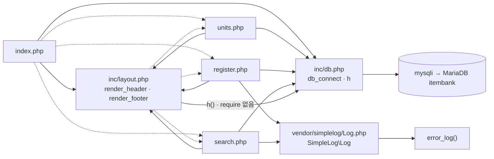

# legacy/item-bank-php 아키텍처

> 범위: 진입점 · 의존 관계 단계까지의 분석 결과다. 데이터 흐름 · 비즈니스 규칙은 아직 다루지 않는다.
> 근거는 `legacy/item-bank-php/` 기준 상대 경로의 `파일:줄번호` 로 적는다.

## 1. 모듈 개요

- 문항 검색 · 문항 등록 · 단원 목록 세 화면을 제공하는 PHP 7.4 + Apache 모듈이다(`Dockerfile:1`).
- 프레임워크 · 라우터 없이 화면 파일 하나가 곧 URL 하나다(`Dockerfile:14`).
- DB 는 `mysqli` 로 MariaDB `itembank` 에 접속한다(`inc/db.php:14-21`).
- 공통 코드는 `inc/`(DB 연결 · 이스케이프 · 레이아웃), 로그는 외부 라이브러리 `vendor/simplelog` 가 맡는다.
- 전체 1,120줄이며 `search.php` 한 파일이 731줄이다.

## 2. 폴더 구조

```
legacy/item-bank-php/
├── Dockerfile                 16줄  php:7.4-apache, mysqli, rewrite 활성화
├── index.php                  14줄  홈 메뉴
├── search.php                731줄  문항 검색
├── register.php              177줄  문항 등록
├── units.php                  48줄  단원 목록
├── inc/
│   ├── db.php                 37줄  db_connect(), h()
│   └── layout.php             43줄  render_header(), render_footer()
└── vendor/
    └── simplelog/
        └── Log.php            54줄  SimpleLog\Log (외부 라이브러리)
```

- `.htaccess` 는 없다. `a2enmod rewrite`(`Dockerfile:3-4`)는 켜져 있지만 리라이트 규칙은 없다.

## 3. 진입점

| URL · 화면 | 처음 실행되는 파일 | 그 파일이 부르는 주요 함수 |
|---|---|---|
| `/index.php` (홈 메뉴) | `index.php` | `render_header('홈')` `index.php:5`, `render_footer()` `index.php:14`. DB 함수는 부르지 않는다 |
| `/` | 미확인 | — |
| `GET /search.php?q=&unit=&level=&tag=&sort=&dir=&page=` (문항 검색) | `search.php` (파라미터 `search.php:5-12`) | `Log::setThreshold` `:27`, `render_header` `:709`, `db_connect` `:713`, `buildSearchQuery($_GET, $conn)` `:722`, `renderSearchForm` `:723`, `runSearchQuery` `:724`, `renderResultTable` `:725`, `Log::error` `:727`, `render_footer` `:731` |
| `GET` · `POST /register.php` (문항 등록) | `register.php` (POST 분기 `register.php:40`, 폼 `:141`) | `db_connect` `:17`, 최상위 코드의 검증 · INSERT `:40-125`(`begin_transaction` `:85`, `commit` `:114`, `rollback` `:120`), `Log::info` `:115`, `Log::error` `:121`, `render_header` `:127`, `render_footer` `:177` |
| `GET /units.php` (단원 목록) | `units.php` | `render_header` `:5`, `db_connect` `:8`, `$conn->query($sql)` `:20`, `h()` `:40-43`, `render_footer` `:48` |

## 4. 의존 관계

### 4.1 그래프

화살표 `A --> B` 는 "A 가 B 를 포함하거나 호출한다"는 뜻이다. 점선은 호출이 아닌 화면 이동(링크 · 폼 제출)이다.



### 4.2 호출 표

**파일 포함 (`require_once`)**

| 호출하는 쪽 → 대상 | 근거 |
|---|---|
| `index.php` → `inc/db.php`, `inc/layout.php` | `index.php:2-3` |
| `units.php` → `inc/db.php`, `inc/layout.php` | `units.php:2-3` |
| `register.php` → `inc/db.php`, `inc/layout.php`, `vendor/simplelog/Log.php` | `register.php:2-4` |
| `search.php` → `inc/db.php`, `inc/layout.php`, `vendor/simplelog/Log.php` | `search.php:20-22` |

**함수 호출**

| 호출하는 쪽 → 대상 | 근거 |
|---|---|
| `units.php` · `register.php` · `search.php` → `db_connect` (`inc/db.php`) | `units.php:8`, `register.php:17`, `search.php:713` |
| `units.php` · `register.php` · `search.php` → `h()` (`inc/db.php:34`) | 예: `units.php:40`, `register.php:131`, `search.php:360` |
| **`inc/layout.php` → `h()` (`inc/db.php`)**. 숨은 의존이다. `layout.php` 에 `require` 가 없어서 `db.php` 를 먼저 포함해야 동작한다 | `inc/layout.php:17`, `:33` |
| `search.php` → `SimpleLog\Log` (`setThreshold` · `debug` · `error`) | `search.php:27`, `:103`, `:528`, `:537`, `:727` |
| `register.php` → `SimpleLog\Log` (`info` · `error`) | `register.php:115`, `:121` |
| `vendor/simplelog/Log.php` → `error_log()`. 레벨이 `threshold` 보다 낮으면 버린다 | `Log.php:52`, `:45-47` |
| `inc/db.php` → `mysqli`, `getenv`. 연결은 `static` 으로 요청 안에서 재사용한다 | `inc/db.php:14-21`, `:9-12` |
| `search.php` 최상위 → `buildSearchQuery` · `renderSearchForm` · `runSearchQuery` · `renderResultTable` | `search.php:722-725` |
| `buildSearchQuery` → `$conn->prepare` · `$conn->query` | `search.php:125`, `:156`, `:178` |

**화면 간 이동 (호출 아님)**

| 출발 → 도착 | 근거 |
|---|---|
| `index.php` · `inc/layout.php` → `search.php` · `register.php` · `units.php` (링크) | `index.php:9-11`, `inc/layout.php:10-12` |
| `search.php` → `search.php` (GET 폼) | `search.php:632` |
| `register.php` → `register.php` (POST 폼) | `register.php:141` |

**DB 객체**

| 테이블 · 뷰 | 쓰는 곳 |
|---|---|
| `unit` | `units.php:16-18`, `register.php:27`, `search.php:125`, `search.php:156` |
| `tag` | `register.php:34`, `search.php:178`, `search.php:244` |
| `item` | `units.php:17`, `register.php:87`, `register.php:93` |
| `item_tag` | `register.php:105`, `search.php:244` |
| `v_item_public` | `search.php:522`, `search.php:245` (정의는 미확인) |

## 5. 가장 긴 함수 3개

`units.php` · `register.php` 에는 함수 정의가 없고 모든 코드가 파일 최상위에 있다.

| 순위 | 파일 · 함수 | 줄 범위 (길이) | 하는 일 |
|---|---|---|---|
| 1 | `search.php` `buildSearchQuery` | `search.php:42-564` (523줄) | GET 파라미터를 검증하고 WHERE · ORDER BY · LIMIT SQL 과 바인딩 값을 조립한다. 선택 목록 DB 조회와 요약 · 경고 · 폼 HTML 생성까지 한 함수에서 한다 |
| 2 | `search.php` `renderResultTable` | `search.php:647-704` (58줄) | 경고 · 요약 · 건수와 결과 표, 페이지 링크(20건 단위)를 출력한다 |
| 3 | `search.php` `runSearchQuery` | `search.php:571-624` (54줄) | 건수 SQL 과 페이지 SQL 을 prepared statement 로 실행해 `total` · `rows` 를 돌려준다 |

함수는 아니지만 `register.php` 최상위 코드(`register.php:1-177`, 177줄)가 실제로는 두 번째로 긴 로직 덩어리다.

## 6. 미확인 목록

- `/` 요청이 `index.php` 로 가는지. Apache 이미지 기본 `DirectoryIndex` 설정을 열어 보지 않았다.
- `v_item_public` 뷰의 정의(`db/mariadb/`). 검색 결과가 공개 문항으로 한정되는지는 이 뷰에 달려 있다.
- 레거시 컨테이너의 포트 · 환경 변수 매핑(`docker-compose.yml`). 코드상 기본값만 확인했다: `DB_HOST=mariadb`, `DB_NAME=itembank`(`inc/db.php:14-18`).
