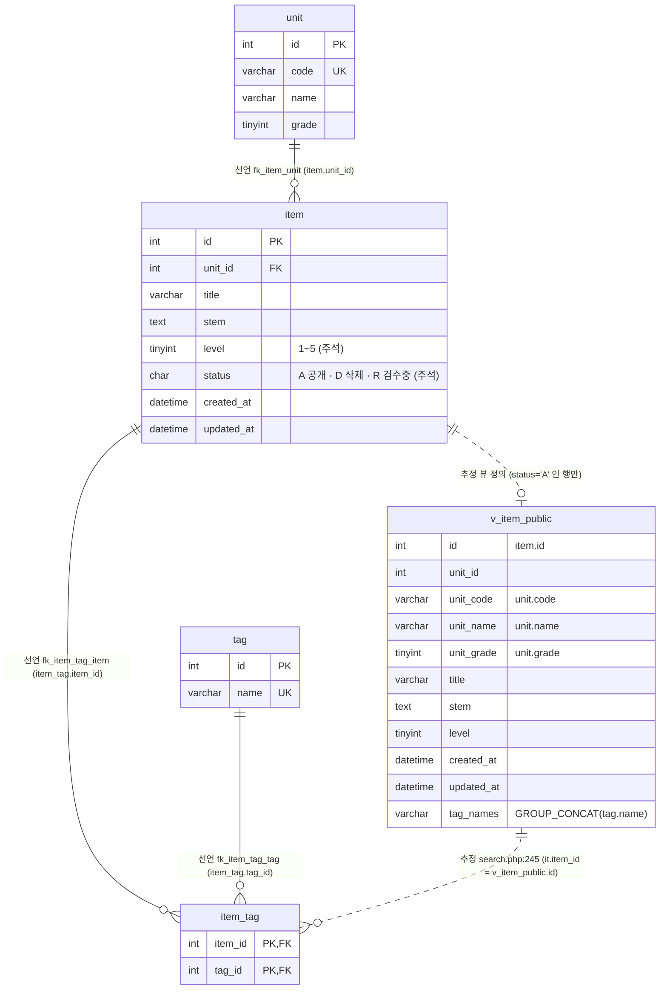

# legacy/item-bank-php 데이터 흐름 · ERD

> 범위: `legacy/item-bank-php/` 가 읽고 쓰는 DB 객체. 선행 문서는 [ARCHITECTURE.md](ARCHITECTURE.md).
> 근거는 저장소 루트 기준 `파일:줄번호` 로 적는다. 레거시 코드 경로는 `legacy/item-bank-php/` 를 생략하고 `search.php:125` 처럼 쓴다.

## 0. 스키마 출처

- 레거시 컨테이너는 `DB_HOST=mariadb`, `DB_NAME=itembank` 로 접속한다(`docker-compose.yml:40-45`, 코드 기본값 `inc/db.php:14-18`).
- `mariadb` 서비스는 `db/mariadb/init` 을 `/docker-entrypoint-initdb.d` 로 마운트하고 데이터 디렉터리가 `tmpfs` 다(`docker-compose.yml:24-27`). 컨테이너를 띄울 때마다 `01-schema.sql` → `02-seed.sql` → `03-users.sql` 이 다시 실행되므로, 이 모듈이 보는 스키마는 `db/mariadb/init/01-schema.sql` 이다.
- 같은 파일의 `class` · `assignment` · `distribution` · `submission` 은 이 모듈 코드에서 참조하지 않는다(§5).

## 1. 테이블 목록

| 테이블 · 뷰 | 주요 컬럼 | 키 · 제약 | 근거 |
|---|---|---|---|
| `unit` (단원) | `id` INT, `code` VARCHAR(16), `name` VARCHAR(100), `grade` TINYINT | PK `id`, UNIQUE `code` | `db/mariadb/init/01-schema.sql:11-18` |
| `item` (문항) | `id` INT, `unit_id` INT, `title` VARCHAR(200), `stem` TEXT, `level` TINYINT(주석 "1~5"), `status` CHAR(1) DEFAULT `'A'`(주석 "A=공개 D=삭제 R=검수중"), `created_at` · `updated_at` DATETIME | PK `id`(AUTO_INCREMENT 없음), FK `unit_id → unit.id`, INDEX `unit_id` · `level` | `db/mariadb/init/01-schema.sql:20-33` |
| `tag` (태그) | `id` INT, `name` VARCHAR(50) | PK `id`, UNIQUE `name` | `db/mariadb/init/01-schema.sql:35-40` |
| `item_tag` (문항-태그 연결) | `item_id` INT, `tag_id` INT | PK (`item_id`, `tag_id`), FK `item_id → item.id`, FK `tag_id → tag.id` | `db/mariadb/init/01-schema.sql:42-48` |
| `v_item_public` (뷰, 공개 문항) | `id`, `unit_id`, `unit_code`, `unit_name`, `unit_grade`, `title`, `stem`, `level`, `created_at`, `updated_at`, `tag_names`(태그 이름 `GROUP_CONCAT`, `t.id` 순, 쉼표 구분) | `item JOIN unit` + `WHERE i.status = 'A'` | `db/mariadb/init/01-schema.sql:52-70` |

- 모든 컬럼이 `NOT NULL` 이다. NULL 허용 컬럼은 이 네 테이블에 없다.
- `level` 의 1~5 범위와 `status` 의 코드 값은 스키마 주석일 뿐 `CHECK` 제약은 없다. 1~5 검증은 등록 화면 코드에 있다(`register.php:70`).

## 2. 테이블 관계

실선은 **선언**(`FOREIGN KEY` 제약), 점선은 **추정**(제약 없이 뷰 정의 · 코드의 조건에서 읽어 낸 관계)이다.

### 2.1 관계별 근거

| 관계 | 구분 | 근거 |
|---|---|---|
| `item.unit_id → unit.id` (N:1) | 선언 | `db/mariadb/init/01-schema.sql:32`. 코드 JOIN: `units.php:17`(`i.unit_id = u.id`), 뷰 `01-schema.sql:69` |
| `item_tag.item_id → item.id` (N:1) | 선언 | `db/mariadb/init/01-schema.sql:46`. 코드 JOIN: 뷰 `01-schema.sql:67` |
| `item_tag.tag_id → tag.id` (N:1) | 선언 | `db/mariadb/init/01-schema.sql:47`. 코드 JOIN: `search.php:244`, 뷰 `01-schema.sql:66` |
| `v_item_public.id` = `item.id` (1:0..1) | 추정 | 뷰가 `item` 한 행당 최대 한 행을 낸다(`01-schema.sql:54`, `:68-70`). 뷰에는 제약이 없다 |
| `item_tag.item_id` = `v_item_public.id` | 추정 | `search.php:244-245` 의 `EXISTS` 부조건. 실제로는 위 두 관계(선언 + 뷰 정의)를 거친 것이다 |

- 코드의 JOIN 은 모두 선언된 FK 와 같은 컬럼 쌍이다. **FK 없이 코드에서만 쓰는 테이블 간 관계는 찾지 못했다.**

## 3. 읽기 · 쓰기 위치

`units.php` · `register.php` 에는 함수 정의가 없어 "(최상위)"로 적는다. `search.php` 의 SQL 은 `buildSearchQuery` 가 문자열로 조립하고 `runSearchQuery` 가 실행한다.

### 3.1 읽기 (SELECT)

| 테이블 · 뷰 | 파일 · 함수 | 줄 | 읽는 컬럼 · 조건 |
|---|---|---|---|
| `unit` | `units.php` (최상위) | `units.php:16-20` | `id, code, name, grade`, `ORDER BY grade, code` |
| `unit` | `register.php` (최상위) | `register.php:27` | `id, code, name` — 단원 선택 목록 · `unit_id` 검증(`:61-68`) |
| `unit` | `search.php` `buildSearchQuery` | `search.php:125` | `name, grade WHERE code = ?` — 요약 문구용 단원명 |
| `unit` | `search.php` `buildSearchQuery` | `search.php:156` | `code, name, grade` — 단원 선택 목록 |
| `item` | `units.php` (최상위) | `units.php:17` | 상관 부조건 `COUNT(*) WHERE unit_id = u.id AND status = 'A'` — 단원별 공개 문항 수 |
| `item` | `register.php` (최상위) | `register.php:87` | `COALESCE(MAX(id), 0) + 1 ... FOR UPDATE` — 새 `id` 채번(잠금 읽기) |
| `item` (뷰 경유) | `search.php` `runSearchQuery` | `search.php:577`, `:600` | `v_item_public` 을 통해서만 읽는다(아래 행) |
| `tag` | `register.php` (최상위) | `register.php:34` | `id, name` — 태그 체크박스 · 태그 검증(`:74-81`) |
| `tag` | `search.php` `buildSearchQuery` | `search.php:178` | `name` — 태그 선택 목록 |
| `tag`, `item_tag` | `search.php` `buildSearchQuery` 조립 → `runSearchQuery` 실행 | 조립 `search.php:244-245`, 실행 `:577`, `:600` | `EXISTS (... it JOIN tag t ... WHERE it.item_id = v_item_public.id AND t.name = ?)` — 태그 이름 필터 |
| `v_item_public` | `search.php` `buildSearchQuery` 조립 → `runSearchQuery` 실행 | 조립 `search.php:521-526`, 실행 건수 `:577`, 페이지 `:600` | SELECT `id, title, unit_code, level, tag_names, created_at`, 건수 `COUNT(*)`. WHERE 에 `title` · `stem`(LIKE, `:98`), `unit_code`(`:118`), `level`(`:215`, `:218`, `:226`), ORDER BY 에 `id` · `title` · `unit_code` · `level` · `created_at`(`:276-327`), `LIMIT 20`(`:523`) |

### 3.2 쓰기 (INSERT · UPDATE · DELETE)

| 테이블 | 파일 · 함수 | 줄 | 내용 |
|---|---|---|---|
| `item` | `register.php` (최상위) | `register.php:92-98` | INSERT `id, unit_id, title, stem, level, status='R', created_at=NOW(), updated_at=NOW()` |
| `item_tag` | `register.php` (최상위) | `register.php:105-111` | 검증된 태그마다 INSERT `(item_id, tag_id)` |

- 두 INSERT 와 채번 SELECT 는 한 트랜잭션이다: `begin_transaction` `register.php:85`, `commit` `:114`, 예외 시 `rollback` `:120`.
- 이 모듈에 `UPDATE` · `DELETE` 문은 없다(`grep -iE 'update|delete|insert|replace'` 결과가 위 두 INSERT 와 `FOR UPDATE` 뿐). `unit` · `tag` 는 읽기만 한다.

### 3.3 테이블별 요약

| 테이블 · 뷰 | 읽는 곳 | 쓰는 곳 |
|---|---|---|
| `unit` | `units.php`(최상위), `register.php`(최상위), `search.php` `buildSearchQuery` | 없음 |
| `item` | `units.php`(최상위), `register.php`(최상위, 채번), `search.php` `runSearchQuery`(뷰 경유) | `register.php`(최상위) INSERT |
| `tag` | `register.php`(최상위), `search.php` `buildSearchQuery` · `runSearchQuery` | 없음 |
| `item_tag` | `search.php` `runSearchQuery`(태그 필터 부조건, 뷰 정의 안의 `tag_names`) | `register.php`(최상위) INSERT |
| `v_item_public` | `search.php` `runSearchQuery` | 해당 없음(뷰) |

## 4. 데이터 흐름에서 보이는 사실

- **등록한 문항은 검색에 바로 나오지 않는다.** `register.php:94` 가 `status='R'` 로 넣고, 검색은 `status='A'` 만 담는 `v_item_public` 을 본다(`01-schema.sql:70`). 단원 목록의 문항 수도 `status='A'` 만 센다(`units.php:17`). 스키마 기본값은 `'A'`(`01-schema.sql:26`)지만 등록 코드는 기본값을 쓰지 않는다.
- **`item.id` 는 애플리케이션이 채번한다.** 컬럼에 AUTO_INCREMENT 가 없고(`01-schema.sql:21`), `MAX(id)+1 ... FOR UPDATE` 로 정한다(`register.php:87`).
- **검색 필터는 코드 · 이름 값으로 건다.** 단원은 `unit_code = ?`(`search.php:118`), 태그는 `t.name = ?`(`search.php:245`)이고, 두 컬럼 모두 UNIQUE 다(`01-schema.sql:17`, `:39`).
- **스키마 주석과 코드가 다르다.** `01-schema.sql:51` 은 "등록 화면이 모두 이 뷰를 기준으로 삼는다"고 적었지만 `register.php` 에는 `v_item_public` 참조가 없다. 등록 화면의 단원 · 태그 목록은 `unit` · `tag` 테이블을 직접 읽는다(`register.php:27`, `:34`).
- `v_item_public` 의 `unit_id` · `unit_name` · `unit_grade` · `stem`(SELECT 목록) · `updated_at` 은 검색 SELECT 목록에 없다. `stem` 은 WHERE 에서만 쓴다(`search.php:98`, `:521`).

## 5. 미확인

- **`status` 를 `R → A` 로 바꾸거나 `D` 로 바꾸는 쪽.** 이 모듈에는 `UPDATE` 가 없다. 검수 완료 · 삭제를 처리하는 코드가 다른 모듈 · 수작업 · 배치 중 어디에 있는지 확인하지 않았다.
- **`item.updated_at` 을 갱신하는 쪽.** 이 모듈은 INSERT 때 `NOW()` 로만 채운다(`register.php:94`).
- **`db/mssql/init/*.sql` 과의 관계.** 레거시 PHP 컨테이너는 MariaDB 에만 접속하므로(`docker-compose.yml:41`) 이 문서에서 읽지 않았다. MSSQL 쪽에 같은 테이블 · 프로시저가 있는지는 미확인이다.
- **같은 DB 의 다른 테이블과의 관계.** `assignment.unit_id → unit.id` FK 가 선언돼 있지만(`01-schema.sql:89`) `assignment` · `class` · `distribution` · `submission` 은 이 모듈이 쓰지 않아 ERD 에서 뺐다. 이 테이블들의 흐름은 `legacy/assignment-thymeleaf` 분석 범위다.
- **`item_tag.tag_id` 단독 인덱스 여부.** 스키마에 명시 선언은 없다. FK 때문에 엔진이 만드는 인덱스는 실제 DB 에서 `SHOW INDEX` 로 확인하지 않았다.
